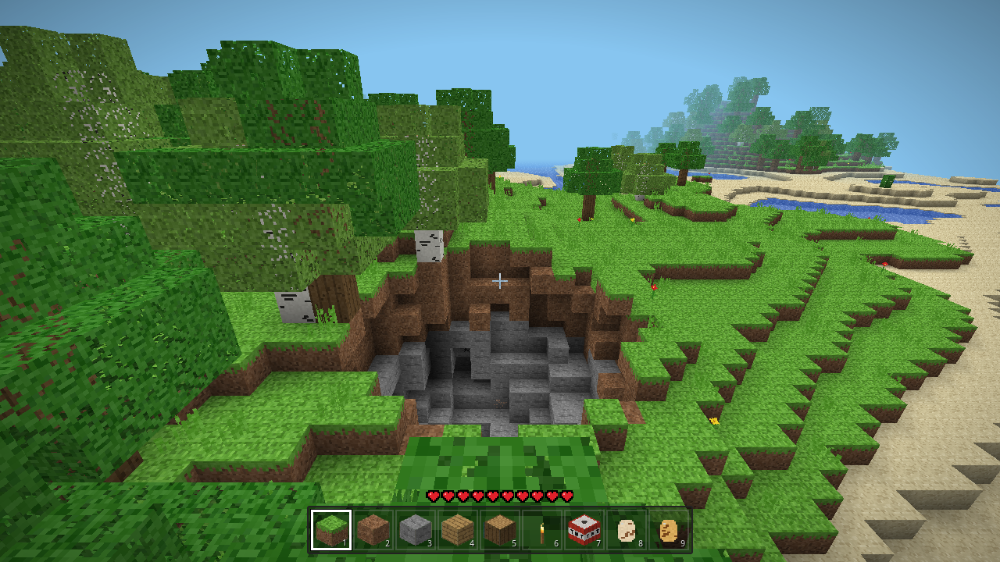
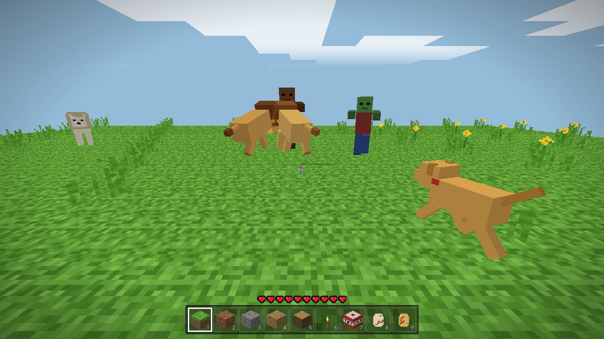

# VoxelCraft

A single-player, Minecraft-style voxel sandbox that runs fully offline in the browser.
No server, no build step: just open `index.html` (double-click / file://).

Controls: mouse look · WASD move · Space jump/swim · Shift sprint (descend while flying) ·
F or double-tap Space toggles flying · Ctrl fast-fly · Left click break · Right click place ·
Middle click pick block · 1-9 / wheel hotbar · E block inventory · F3 debug HUD · Esc pause/settings.

World edits, player position, time of day and hotbar auto-save to localStorage.
Three.js r160 (MIT) is vendored in `vendor/`.

## Mobile / touch

On phones and tablets the game shows touch controls. Choose **Touch controls: Auto / On / Off** on the start screen or in the pause menu,
or press **T**. Your choice is saved, and switching takes effect right away. `?mobile=1` / `?mobile=0` overrides it until you change the toggle.
With touch controls on and a mouse attached, clicking the game captures the mouse for looking and clicking, and Esc releases it without pausing.
Touch controls:
left-thumb joystick to move, drag on the right to look, tap to place, long-press to break,
buttons for jump/fly-up, fly-down, fly toggle, sprint, break, place, a pause menu, a tilt-look toggle and a recenter button.
Tap a hotbar slot to select it; `⋯` opens the block menu.
Tilt look uses the gyroscope (DeviceOrientation). iOS asks for motion permission when you tap Play or "Enable tilt look",
and tilt turns on once you allow it. Tilt and touch-drag work together. Sensitivity sliders are in the pause menu.
Mobile defaults: render distance 4, pixel ratio 1.

## Torches, lighting & pets

- **Torches** go on floors or walls (place on the side of a block). Torches, lanterns, glowstone and jack o'lanterns
  give off real block light (flood fill, levels 0-15), built into the chunk meshes with a warm flicker. That light lights
  up caves and nights, and updates across chunk borders when you place or break blocks. Breaking the block a torch is
  attached to drops the torch.
- **Dogs & cats** (6 coats each) spawn on grass near you and wander around: they idle, walk, hop up 1 block and avoid
  water and big drops. Use a **spawn egg** from the block menu to place one.
  Right-click / tap an animal to tame it (it gets a collar and follows you); do it again to make it sit or follow.
  Left-click / long-press pets a tamed animal, or shoos a wild one away. Tamed and egg-spawned animals are saved with the world.
  Animal sounds can be turned off in the pause menu.
- More blocks: lantern, crafting table, pumpkin, jack o'lantern, 9 more wool colours, mossy cobblestone, hay bale,
  melon, terracotta, blue orchid, pink tulip, red mushroom (flowers can be placed on grass/dirt).

## TNT, lions, zombies & health

- **TNT** is in the block menu, and new worlds start with it in the hotbar. Place it, then right-click / tap it to light
  it. It turns into a flashing block that falls and explodes after about 4 seconds. The explosion leaves a ragged
  crater about 4 blocks across in every direction. Bedrock can't be destroyed. TNT that goes off in water doesn't break
  any blocks. Nearby TNT is set off in a chain reaction. Explosions hurt and knock back you and the mobs around you,
  and come with screen shake, a flash, smoke, sparks and a boom. Shift+right-click places a block against TNT without
  lighting it. The game limits how many explosions it handles at once (lower on mobile) and remeshes the crater in
  batches.
- **Lions** sometimes spawn on grass and sand, and the **Lion Spawn Egg** places one. Wild lions are neutral, but they
  fight back if you hit them. Tame a lion like a dog or cat: right-click / tap it. A tamed lion follows you, and
  tapping it again makes it sit. A following lion roars and pounces on zombies near you, and on anything that hurts
  you. Tamed dogs help fight too.
- **Zombies** spawn at night on dark ground and in dark caves. They won't spawn near torches or other lights (block
  light 7 or more). They chase you and hit you, and they burn up in daylight. Left-click / long-press to fight back.
  You can switch **Hostile mobs** off in the pause menu: zombies go away and mobs can't hurt you any more.
- **Health**: you have 10 hearts. They regenerate slowly after a few seconds without damage. When you die, a respawn
  screen appears and you come back at the world spawn point. The world is kept.

### Tilt look troubleshooting

The pause menu has a **Tilt status** line. It says whether permission was granted or denied, whether the game is still
waiting for the sensor, or whether data is arriving (with the event rate and the live α/β/γ values).

- **Android Chrome** doesn't show a permission prompt; it allows motion sensors silently. If the status says no
  sensor data, motion sensors are blocked for the site. Fix it under ⓘ / lock icon › Permissions › Motion sensors ›
  Allow, then reload. Phones without a gyroscope fall back to the compass-based (absolute) orientation. Phones with
  only an accelerometer get "steer" mode: lean the phone left or right to turn.
- **iPhone / iPad**: tap *Tap to Play* or *Enable tilt look* and allow motion access when asked. If you denied it
  before, Safari won't ask again until you close it completely and reopen it, or clear this site's data
  (Settings › Safari › Advanced › Website Data).
