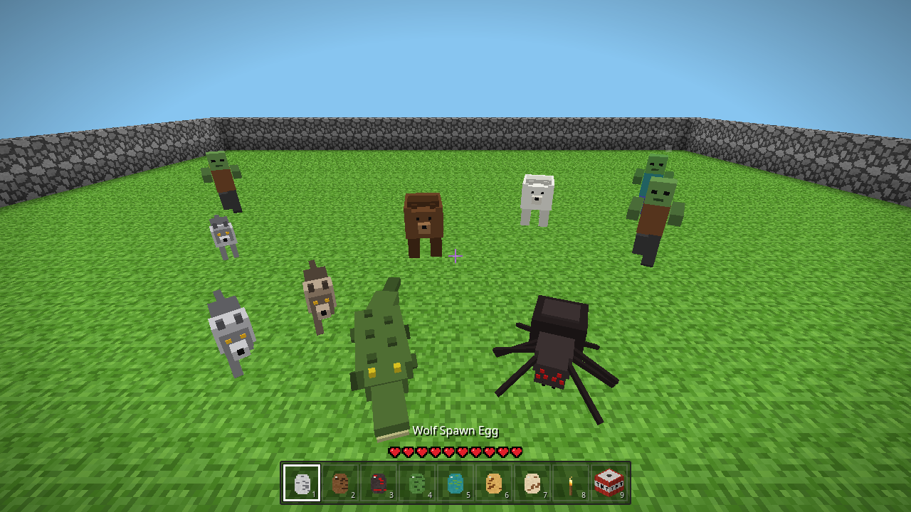
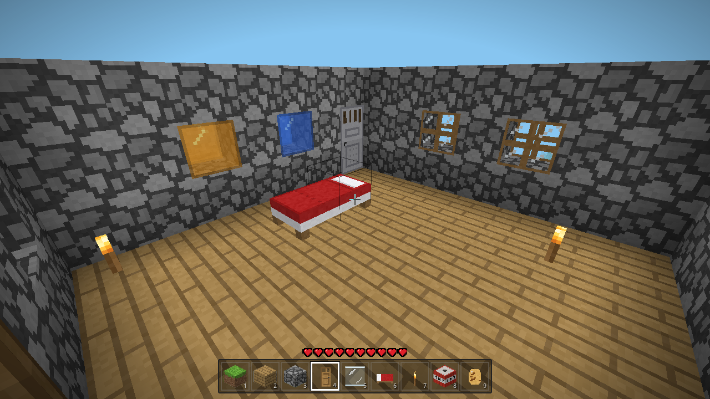
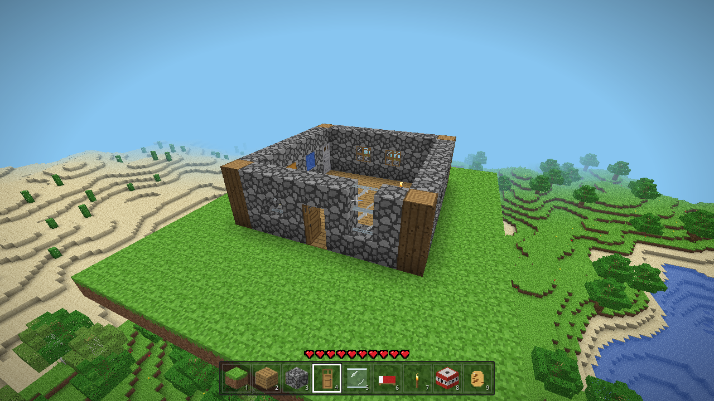
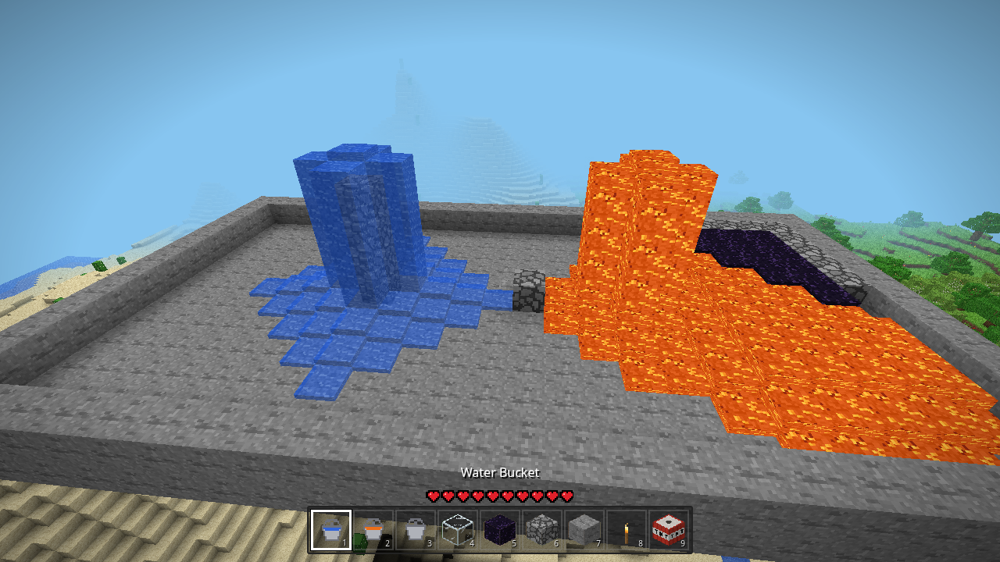
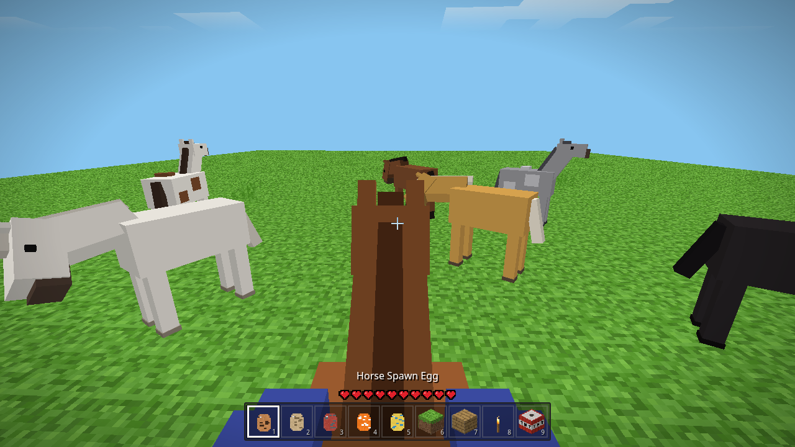
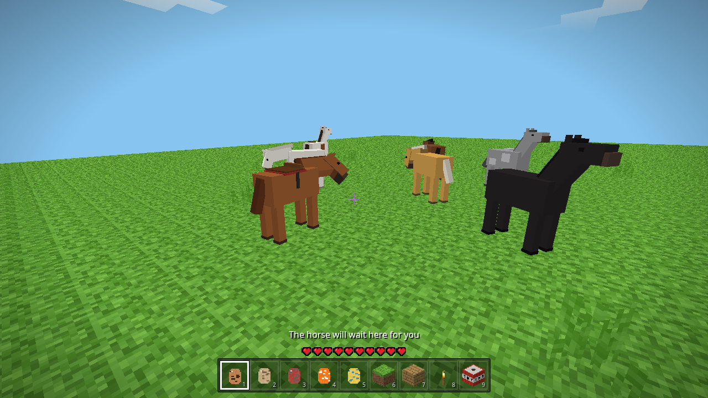
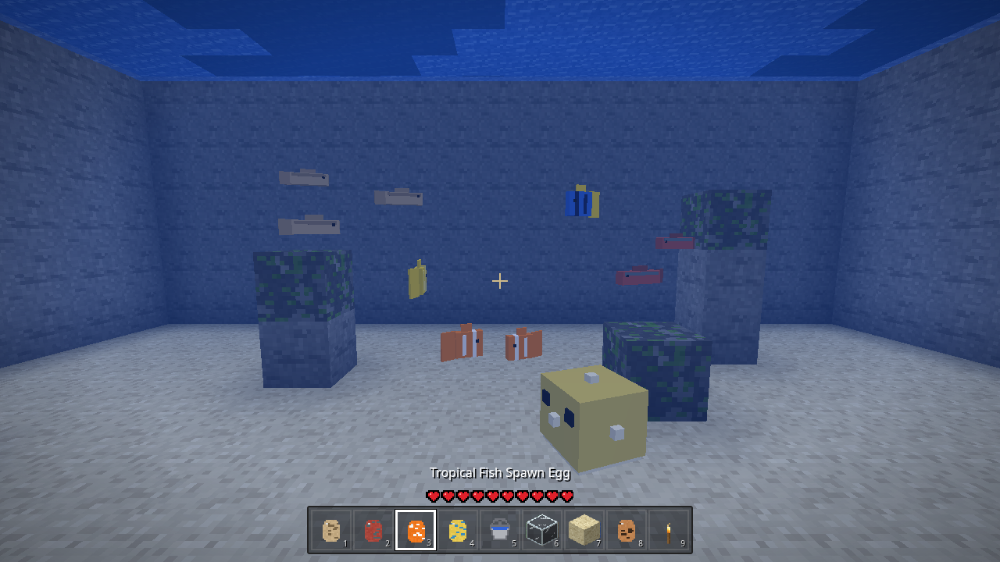
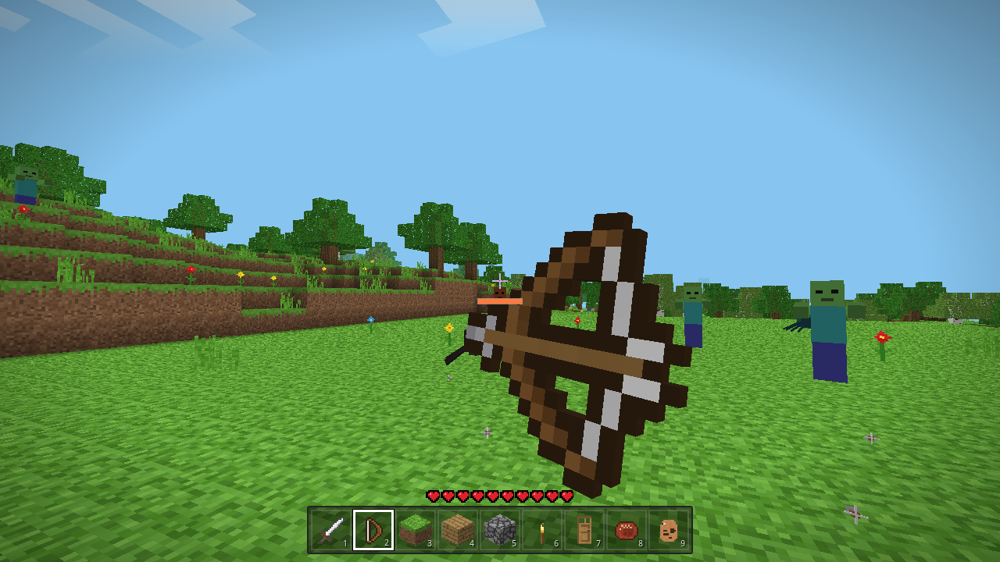
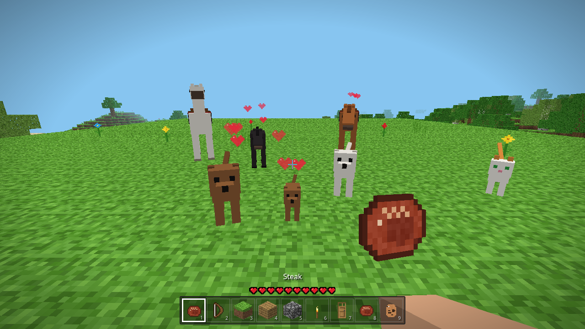

# VoxelCraft

A single-player, Minecraft-style voxel sandbox that runs fully offline in the browser.
No server, no build step: just open `index.html` (double-click / file://).

Controls: mouse look · WASD move · Space jump/swim · Shift sprint (descend while flying) ·
F or double-tap Space toggles flying · Ctrl fast-fly · Left click break · Right click place ·
Middle click pick block · 1-9 / wheel hotbar · E block inventory · F3 debug HUD · M mute · Esc pause/settings.
Hold right click with a bow or trident to draw, release to shoot.

World edits, player position, time of day and hotbar auto-save to localStorage.
Three.js r160 (MIT) is vendored in `vendor/`.

## Mobile / touch

On phones and tablets the game shows touch controls. Choose **Touch controls: Auto / On / Off** on the start screen or in the pause menu,
or press **T**. Your choice is saved, and switching takes effect right away. `?mobile=1` / `?mobile=0` overrides it until you change the toggle.
With touch controls on and a mouse attached, clicking the game captures the mouse for looking and clicking, and Esc releases it without pausing.
Touch controls:
left-thumb joystick to move, drag on the right to look, tap to place, long-press to break,
buttons for jump/fly-up, fly-down, fly toggle, sprint, break, place, a pause menu, a tilt-look toggle, a recenter button and 🔊 mute.
With a bow or trident in hand, a 🏹 fire button replaces place: hold it to draw, release to shoot (long-pressing the view works too).
Tap a hotbar slot to select it; `⋯` opens the block menu.
Tilt look uses the gyroscope (DeviceOrientation). iOS asks for motion permission when you tap Play or "Enable tilt look",
and tilt turns on once you allow it. Tilt and touch-drag work together. Sensitivity sliders are in the pause menu.
Mobile defaults: render distance 4, pixel ratio 1.

## Torches, lighting & pets

- **Torches** go on floors or walls (place on the side of a block). Torches, lanterns, glowstone and jack o'lanterns
  give off real block light (flood fill, levels 0-15), built into the chunk meshes with a warm flicker. That light lights
  up caves and nights, and updates across chunk borders when you place or break blocks. Breaking the block a torch is
  attached to drops the torch.
- **Dogs & cats** (6 coats each) spawn on grass near you and wander around: they idle, walk, hop up 1 block and avoid
  water and big drops. Use a **spawn egg** from the block menu to place one.
  Right-click / tap an animal to tame it (it gets a collar and follows you); do it again to make it sit or follow.
  Left-click / long-press pets a tamed animal, or shoos a wild one away. Tamed and egg-spawned animals are saved with the world.
  Animals can also be tamed, healed and bred with food (see *Feeding* below).
- More blocks: lantern, crafting table, pumpkin, jack o'lantern, 9 more wool colours, mossy cobblestone, hay bale,
  melon, terracotta, blue orchid, pink tulip, red mushroom (flowers can be placed on grass/dirt).

## TNT, lions, zombies & health

- **TNT** is in the block menu, and new worlds start with it in the hotbar. Place it, then right-click / tap it to light
  it. It turns into a flashing block that falls and explodes after about 4 seconds. The explosion leaves a ragged
  crater about 4 blocks across in every direction. Bedrock can't be destroyed. TNT that goes off in water doesn't break
  any blocks. Nearby TNT is set off in a chain reaction. Explosions hurt and knock back you and the mobs around you,
  and come with screen shake, a flash, smoke, sparks and a boom. Shift+right-click places a block against TNT without
  lighting it. The game limits how many explosions it handles at once (lower on mobile) and remeshes the crater in
  batches.
- **Lions** sometimes spawn on grass and sand, and the **Lion Spawn Egg** places one. Wild lions are neutral, but they
  fight back if you hit them. Tame a lion like a dog or cat: right-click / tap it. A tamed lion follows you, and
  tapping it again makes it sit. A following lion roars and pounces on zombies near you, and on anything that hurts
  you. Tamed dogs help fight too.
- **Zombies** spawn on dark ground and in dark caves, mostly at night (see *Daytime hostiles* below for the day). They won't spawn near torches or other lights (block
  light 7 or more). They chase you and hit you, and they burn up in daylight. Left-click / long-press to fight back.
  You can switch **Hostile mobs** off in the pause menu: zombies go away and mobs can't hurt you any more.
- **Health**: you have 10 hearts. They regenerate slowly after a few seconds without damage. When you die, a respawn
  screen appears and you come back at the world spawn point. The world is kept.

## Predators, beds, doors, windows, water & lava

- **Predators** (all hostile; switching **Hostile mobs** off in the pause menu removes them and stops them spawning):
  - **Wolves** hunt in packs of 2–3 in forests at night. They stalk you slowly, then rush in (3 damage a bite, 6 hearts of
    health).
  - **Bears** (brown, black, or polar on snow) live in forests and snowy areas, by day too. They are slow but hit hard
    (6 damage, 17 hearts).
  - **Spiders** come out at night and in caves. They climb walls and leap at you (2 damage).
  - **Crocodiles** lurk at the water's edge and swim fast (5 damage).
  - Each predator has its own blocky model, animation and sound. Tamed **lions and dogs** attack predators that come near
    you, and anything that hurts you. Tamed animals slowly heal.
  - Every predator (and the zombie) has a **spawn egg** in the block menu, so you can test them. The eggs do nothing while
    hostile mobs are off.
- **More zombies**: they spawn more often at night and in caves, sometimes in small hordes. At most 16 hostile mobs are
  around at once (7 on mobile). Torches still keep monsters from spawning (block light 7 or more).
- **Beds**: place one and it lies along the way you're facing (2 blocks). Right-click / tap it to set your **spawn
  point** next to the bed. At night you can **sleep**: the screen fades and it becomes morning. You can't sleep if a
  monster is within 8 blocks.
- **Doors**: oak and iron doors are 2 tall and face away from you when placed. Right-click / tap to open or close one.
  A closed door blocks you and mobs; an open one swings against the side of its block. A door won't close on you.
  Breaking either half breaks the whole door, and so does breaking the block under it. Door states are saved.
- **Windows**: **glass panes** are thin and join up with each other and with walls. There are also **oak-frame
  windows** and **blue / amber stained glass**. They all render as see-through.
- **Water & lava**:
  - Use the **water bucket** and **lava bucket** to place a source block. The empty **bucket** scoops up a source.
  - Both flow down and a few blocks sideways (water 3 blocks, lava 2), and dry up when their source is gone.
  - Water meeting a lava source makes **obsidian**; water meeting flowing lava makes **cobblestone**.
  - Lava glows, slows you down, burns you (3 damage every half second, then you keep burning for a few seconds unless
    you jump in water), and also hurts mobs.
  - Deep caves now have lava lakes at the bottom.
  - The flowing is calculated in small batches, a few times a second (fewer blocks per update on mobile), so it never
    stalls the game.
- **New-world hotbar**: iron sword, bow, grass, planks, cobblestone, torch, oak door, steak and horse egg. Everything else is
  in the block menu (**E**, or **⋯** on touch). **Shift + right-click** places a block against a door or bed instead of
  using it.

## Horses & fish

- **Horses** live in herds of 1–3 on open grassland (plains without trees). They come in 7 coats: chestnut, bay, black,
  white, dapple gray, palomino and paint. Each one has a mane, a tail and a walking / galloping gait, and it grazes now and
  then. The **Horse Spawn Egg** (last hotbar slot in new worlds) puts one down wherever you like.
  - **Right-click / tap a horse** to tame it (a saddle appears) and climb on. **Shift + right-click** tames it without
    getting on.
  - While riding, the camera is at rider height and you can see the rider's legs. **WASD** or the **joystick** steers.
    Riding speed is about 6 blocks/s, or about 10.5 when you gallop (**Ctrl**, or **»** on touch). **Space** / **▲**
    jumps about 2.5 blocks, and the horse steps up 1 block on its own.
  - Horses swim slowly, paddle up with Space, and won't walk into lava.
  - **Shift** (or the **⏏** button on touch, which only shows while riding) gets you off beside the horse. A tamed horse
    stays where you left it and is saved with the world.
  - Hostile mobs still attack you while you ride. If you hit a wild horse, it bolts.
- **Fish**: **cod**, **salmon**, **tropical fish** (clownfish, blue tang, yellow tang) and **pufferfish**, each with an
  animated swimming model.
  - Schools spawn naturally in water deep enough (2+ blocks) and despawn when far away. At most 16 fish are around at
    once (6 on mobile).
  - Each type has a **spawn egg**. Use it on water (it also works looking through glass, so you can stock an aquarium).
    Fish released this way are kept with the world.
  - Fish only swim inside water and dart away when you get close. A pufferfish puffs up instead.
  - Out of water a fish flops around and slowly dies.

## Weapons, feeding & sound

- **Weapons** are in the block menu, and new worlds start with an iron sword and a bow. You see them in first person,
  with a swing animation. Every hit makes the mob flash white, then red, and knocks it back.

  | Weapon | Damage | Notes |
  |---|---|---|
  | Fist | 3 | |
  | Wooden / stone / iron / diamond sword | 4 / 5 / 6 / 8 | Fast swing |
  | Iron axe | 7 | Slow swing, big knockback |
  | Bow | 2–9 (by draw) | Ranged |
  | Trident | 7 melee, 4–9 thrown | Longer reach (6.5 blocks), thrown with a hold |

  - **Bow**: hold right click (on touch, hold 🏹 or the place button, or long-press the view) to draw; the charge bar
    fills in about 1 s and you walk slower while drawing. Release to shoot. Arrows fly with gravity, slow down in water,
    stick in blocks (they fall if the block goes), and fade after 40 s. A quick click or tap fires a weak shot. Arrows
    are unlimited and pass by tamed animals and the horse you ride.
  - **Trident**: hold to throw. It returns to you after it hits something.
- **Daytime hostiles**: zombies, wolves, spiders and the other predators now also come out by day, less often than at
  night and with a lower cap (60% of the normal limit of 16, or 7 on mobile). Torches still stop spawns nearby, and the
  **Hostile mobs** switch still turns them all off.
- **Feeding**: the block menu has **steak, bone, cooked fish, apple, carrot and wheat**, and hay bales work as horse food.
  Right-click or tap an animal while holding its food:

  | Animal | Food |
  |---|---|
  | Dog | bone, steak |
  | Cat | cooked fish |
  | Lion | steak |
  | Horse | apple, carrot, wheat, hay |

  - Food heals the animal, and hearts float up. A few feeds tame a wild one. Tapping a dog, cat or lion with an empty
    hand still tames it as before.
  - Feed two tamed animals of the same kind that are near each other, and they fall in love and have a **baby**. The baby
    is a half-size, tamed copy that grows up over about 4 minutes; food speeds that up. Foals can't be ridden. Each
    parent has to wait a minute before it can breed again. Babies are saved with the world.
  - Food the animal doesn't eat does the normal tap action instead (sit, follow, ride).
  - You can **eat** food yourself: right-click or tap while not aiming at an animal. Steak +4 hearts, fish 2.5, apple
    2, carrot 1.5; bones and wheat are animal food only.
- **Sound** is all synthesized live with WebAudio, so there are no audio files:
  - **Footsteps and blocks**: footsteps per material (grass, gravel, sand, snow, wood, stone, glass, wool, metal,
    water), and break and place sounds.
  - **Combat and creatures**: sword swing and hit, axe, bow draw, twang and arrow thunk, trident, mob hurt and death,
    eating, splashes and swimming, horse hooves.
  - **Ambience**: birdsong by day; crickets and owls at night; drips, rumble and a drone in caves; a muffled hum
    underwater.
  - **Music**: gentle generative background music plays now and then.
  - **Controls**: the pause menu has **Master, Music, Effects and Mobs** volume sliders (saved) and a mute button (also
    **M**, or 🔊 on touch). Browsers only allow sound after a first tap or click, so sound starts on your first touch.

### Tilt look troubleshooting

The pause menu has a **Tilt status** line. It says whether permission was granted or denied, whether the game is still
waiting for the sensor, or whether data is arriving (with the event rate and the live α/β/γ values).

- **Android Chrome** doesn't show a permission prompt; it allows motion sensors silently. If the status says no
  sensor data, motion sensors are blocked for the site. Fix it under ⓘ / lock icon › Permissions › Motion sensors ›
  Allow, then reload. Phones without a gyroscope fall back to the compass-based (absolute) orientation. Phones with
  only an accelerometer get "steer" mode: lean the phone left or right to turn.
- **iPhone / iPad**: tap *Tap to Play* or *Enable tilt look* and allow motion access when asked. If you denied it
  before, Safari won't ask again until you close it completely and reopen it, or clear this site's data
  (Settings › Safari › Advanced › Website Data).
