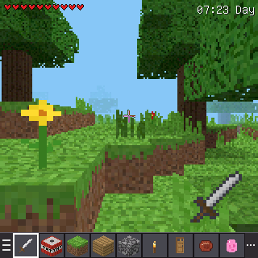
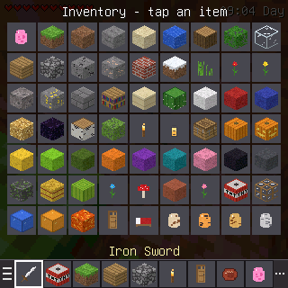
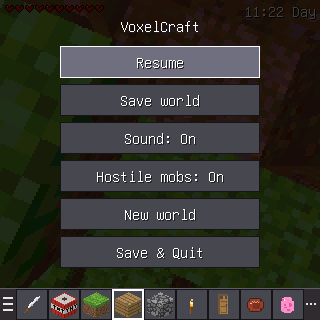
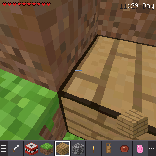
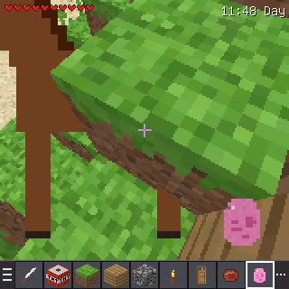
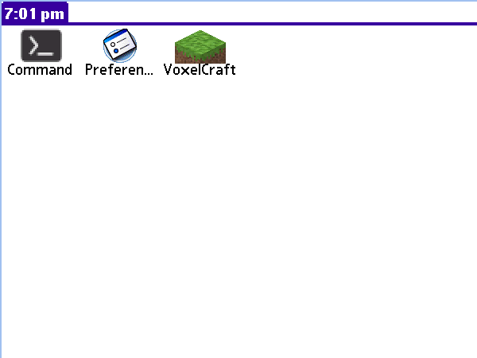
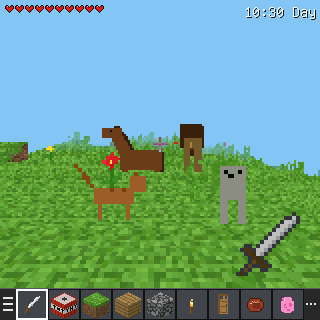
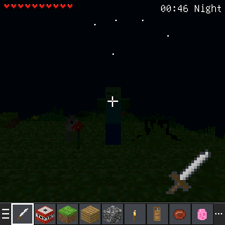
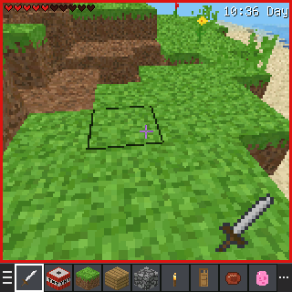

# VoxelCraft for Palm Tungsten E2

This is a native Palm OS port of VoxelCraft for the **Palm Tungsten E2**:
- Palm OS 5.4.7 Garnet;
- 200 MHz Intel XScale PXA255;
- 320×320 16-bit colour screen.

The whole thing ships as one HotSync-able file, **`VoxelCraft.prc`** (about 228 KB, creator `VxCf`, version 1.0.1).

**Download:** [VoxelCraft.prc](https://github.com/jpfeiffer16/voxelcraft/releases/download/palm-v1.0.1/VoxelCraft.prc) (release `palm-v1.0.1`), or use [`palm/VoxelCraft.prc`](VoxelCraft.prc) in this repo.

If you installed 1.0 and it died with a Fatal Exception during "Growing trees..." (or just after terrain finished), install **1.0.1** over it with another HotSync. 1.0 ran in the PumpkinOS emulator but crashed on a real Tungsten E2; see "1.0.1 fixes" below.

| Emulator (PumpkinOS, real .prc) | | |
|---|---|---|
|  |  |  |
|  |  |  |

| Same core on the PC test harness | | |
|---|---|---|
|  |  |  |

`screenshots/arm_unicorn_frame.png` is a frame drawn by the real ARM code. It was run instruction by instruction in the Unicorn ARM emulator (see "How it was tested").

## Installing it with HotSync

Your handheld must already be set up to sync with a Palm Desktop / HotSync Manager install, or with pilot-link on Linux. VoxelCraft needs about 2.3 MB of free RAM while it runs. A stock E2 has plenty.

### Windows (Palm Desktop 4.x or 6.x)
1. Download `VoxelCraft.prc`.
2. Either double-click `VoxelCraft.prc` or drag it onto the **Palm Quick Install** icon on the desktop. You can also open Palm Desktop and use **Quick Install** (called **Install Tool** in 4.x). Then check that your handheld name is selected in the **User** list and that VoxelCraft is queued under **Handheld**.
3. Put the Tungsten E2 in its cradle or connect its USB cable, then press the **HotSync** button on the cradle or cable. You can also tap **Home → HotSync → (Sync)** on the handheld.
4. After the sync finishes, tap **Home** on the handheld. The **VoxelCraft** icon (a grass block) is in the *All* category.

### Mac (Palm Desktop 4.2)
1. Download `VoxelCraft.prc`.
2. Drag it onto the **Send To Handheld** droplet. You can also use **HotSync Manager → Install Handheld Files**: choose your user name, click **Add to List…**, and pick the file.
3. Connect the E2 and press the **HotSync** button.
4. Tap **Home** on the handheld to find **VoxelCraft**.

### Linux (pilot-link)
```sh
pilot-xfer -p usb: -i VoxelCraft.prc
```
Run the command, then press the **HotSync** button on the cradle or cable within a few seconds. Some setups need `-p /dev/ttyUSB1` (visor module) or `-p net:any`. The `usb:` port needs pilot-link built with libusb.

### SD card (no HotSync)
1. Copy `VoxelCraft.prc` to an SD card in the folder **`/PALM/Launcher/`**.
2. Insert the card into the E2. The launcher switches to the card, and you can tap **VoxelCraft** to run it from there.
3. To copy it into RAM instead, use **Home → menu → App → Copy…**, set **Copy To: Handheld**, and choose VoxelCraft.

### Removing it
Use **Home → menu → App → Delete…**, then delete **VoxelCraft**. The world save, a separate database called `VoxelCraftSave`, is removed along with it because it has the same creator ID.

### Backups
The app and its save database both have the **backup bit** set, so every HotSync backs up your world to the PC.

## Controls

| Input | Action |
|---|---|
| 5-way **Up / Down** | Walk forward / backward |
| 5-way **Left / Right** | Turn |
| 5-way **Center** | Jump |
| **Calendar** button (1st) | Jump (swim up in water) |
| **Contacts** button (2nd) | Break block / attack |
| **Tasks** button (3rd) | Place block / use item (eat, tame, ride, light TNT, sleep, open doors); also gets off a horse |
| **Note Pad** button (4th) | Open / close block inventory |
| **Menu** silkscreen button | Menu: Resume, Save world, Sound on/off, Hostile mobs on/off, New world, Save & Quit |
| **Home** silkscreen button | Quit (the world is saved first) |
| Stylus **drag** on the view | Look around (yaw and pitch) |
| Stylus **tap** on the view | Place / use at the tapped spot |
| Stylus **hold** (400 ms) on the view | Break / attack at that spot (repeats) |
| Stylus tap on the **hotbar** | Select slot; ☰ (left) opens the menu, ⋯ (right) opens the inventory |
| Inventory screen | Tap an item to put it into the selected hotbar slot |

Sound uses the system **Game Sound** volume (Prefs → Sounds & Alerts).

## What's in it (kept from the web version)

- **Renderer and world**
  - Fixed-point, per-pixel voxel raycaster with the same 16×16 textures as the web version. Faces are shaded by side, light comes from block light and sky light, and there is distance fog and sky colour that change with the time of day.
  - Billboard sprites for mobs and a held-item view.
  - The web version's terrain generator, ported to fixed point. It generates hills, beaches, oceans, forests (oak and birch), deserts with cactus, snow, caves and ores. Tall grass and flowers are drawn as cross-sprites.
- **Blocks and items:** the web version's 73 block and item types, including:
  - wool colours, glass, stained glass, windows, doors and beds;
  - torches, lanterns and glowstone, all of which light the world;
  - TNT, lava (which damages you) and water (you can swim);
  - four swords and an iron axe;
  - steak and apples as food;
  - spawn eggs, including the **pink Horse Spawn Egg**.
- **Day and night:** a **12-minute (720 s) cycle**, the same phases as the web version. There is a clock and phase readout in the HUD, stars and darkness at night, and sleeping in a bed skips the night.
- **Health:** 10 hearts, damage from mobs, TNT and lava, drowning-free swimming, death and respawn, and food that heals.
- **Mobs with AI:**
  - zombies and spiders, which are hostile at night;
  - forest wolf packs, by day too, as on the web;
  - dogs, cats, horses and lions.
  - Lions are neutral and fight back when hit.
  - You can tame and feed animals. Tamed dogs and wolves protect you, and tamed horses can be ridden.
- **TNT:** light it, and after the fuse it explodes, carving a crater, damaging you and mobs, and knocking them back.
- **Sound:** short synthesized tones played with `SndDoCmd` for steps, breaking, placing, hits, mob voices, eating, explosions and death.
- **Saving:** world edits, player position, health, time, hotbar, settings and mobs are saved to the Palm database `VoxelCraftSave` (type `DATA`, creator `VxCf`, backup bit set). The game saves on quit, every 5 minutes, and from the menu. The format stores only the difference from the generated world, so saves are small.

## What was cut or simplified (and why)

- **World size and terrain**
  - The world is a finite **96×96×64** island surrounded by ocean, not an endless world. Mountains are compressed to fit 64 blocks of height. The world, its light and the renderer's tables use about 2.1 MB of the E2's dynamic heap.
  - View distance is 24 blocks, with fog.
  - The display is rendered at **160×144 and doubled** to 320×288. The hotbar (y 288–319) is drawn at full 320-pixel resolution.
- **Missing or simplified features**
  - No flowing water or lava: fluids are static source blocks.
  - No bow, trident, fishing, bears or crocodiles. No flying mode.
  - Breaking is instant; there is no mining time.
  - Torches only stand on floors.
  - One coat or texture per mob type, drawn as camera-facing sprites instead of 3D models.
  - No clouds or particles. TNT does not fall or slide.
- **Sound:** the Palm OS sound API plays one tone at a time, so the layered web soundscape is reduced to the most important event each frame.


## 1.0.1 fixes (real Tungsten E2 crash)

Version 1.0 started on a real E2 and drew the loading screen, then threw a **Fatal Exception** (with a reset notice, and no further error text) when the progress bar said "Growing trees...". PumpkinOS is much more lenient than Garnet 5.4 on an XScale, so 1.0.1 tightens the code against real-device rules.

Most likely causes, in order:

1. **Tree generation and lighting ran as one long ARM call after the "Growing trees..." label was already on screen.** Lighting walked a queue of linear block indices with 32-bit `%` and `/`. On ARM those become libgcc helpers, and a bug or a bad helper can data-abort. The queue now stores packed x/y/z, so it never divides. Trees are generated four rows at a time so Palm OS can paint and reset the auto-off timer. The label now matches the work that is *about to run*: you will see "Lighting..." *before* lighting starts. `tset()` already clipped leaves at the map edge; that clip is kept, and the dirt-under-tree write is bounds-checked too.
2. **XScale alignment faults.** A 32-bit load or store at a 2-byte address is a data abort on the PXA255. ArmArgs may only be 2-aligned (Palm OS 68K heap), so the ARM entry now reads and writes every field byte-wise in big-endian order. `vc_present` no longer assumes the screen bitmap is 4-aligned. Const tables are 4-aligned. The ARM code is copied to a 4-aligned chunk if the locked resource is not. The game block is rejected if it isn't 4-aligned.
3. **2.1 MB game block.** `MemChunkNew` uses `memNewChunkFlagAllowLarge` (required on OS 5 above 64 KB). If the dynamic heap can't fit it, the app falls back to the storage heap (`FtrPtrNew`) and takes the write semaphore around each ARM call. A failure shows how much memory is free, instead of crashing.
4. **Small 68K stack and defensive startup.** The `'pref'` resource now requests a 16 KB stack (it was 4 KB). Startup checks the OS version, ARM, screen, and heap, and writes a short stage name to a `VxLg` database before each step. If the app still dies, the next launch shows an alert: "The last launch stopped during: …".

Other real-device hardening (less likely to have been the 1.0 crash, since 1.0 got as far as the loading screen):

- `PceNativeCall` already byte-swaps the `userData` *pointer* (Palm's own docs). Only the *contents* of ArmArgs are swapped, now with alignment-safe helpers.
- `BmpGetDimensions` supplies the true row stride; we no longer assume 640 bytes.
- Pixel endianness comes from `WinScreenGetAttribute(winScreenPixelFormat)`.
- `PilotMain` ignores launch codes other than a normal launch (so a HotSync notify can't touch globals).
- The ARM blob is still one position-independent resource, no `.got`/`.data`/`.bss`, under 64 KB.

## Performance

- **Framerate:** about **7–11 frames per second**, estimated. The frame cost was measured by running the real ARM code in Unicorn and counting instructions, then converting with an XScale CPI of 1.3–2.0:
  - 11.0–16.3 M instructions per frame;
  - plus 0.46 M for the 565 blit;
  - plus the OS `WinDrawBitmap`.
- **World generation:** about **2–3 s** (324 M instructions). Loading a save regenerates the world from its seed, then applies your edits.
- This has not been timed on a physical Tungsten E2.

## How it was tested (and what was not)

- **PumpkinOS emulator**
  - The built `VoxelCraft.prc` was installed into PumpkinOS, an open-source Palm OS 5 re-implementation, running on X11.
  - The launcher shows the icon and name. The app starts, generates the world and renders, which proves the 68K shell → `PceNativeCall` → ARM core path, run through PumpkinOS's Unicorn ARM plug-in.
  - Tested by scripted input there: walking and turning with the 5-way, stylus look, breaking with Contacts, placing with Tasks and with stylus taps, hotbar taps, inventory with Note Pad, the menu, the horse egg spawning a horse, and jumping.
  - Saving on exit and loading on relaunch work: the time of day and broken or placed blocks persist.
  - Screenshots are in `screenshots/emu_*.png`.
- **Not tested on a real device or on real Palm firmware**
  - PumpkinOS is a re-implementation, not Palm's ROM. No genuine Tungsten E2 ROM was available, and none was downloaded, because they are copyrighted.
  - Real-device behaviour that differs from PumpkinOS was handled by following the Palm OS 5 SDK documentation:
    - pen coordinates come from `EvtGetPenNative`;
    - pen events reach `SysHandleEvent` so the silkscreen buttons work;
    - the 5-way left/right uses `keyBitNavLeft` and `keyBitNavRight`.
- **Unicorn ARM runs:** `tools/armbench.py` loads the actual `ARMC` resource into the Unicorn ARM emulator, then runs setup, world generation and frames with the same calling convention. It reports instruction counts and writes an image of the frame.
- **Stricter Unicorn test:** `tools/armstrict.py` (or `make strict`) maps the PNOlet at a high address with no relocations, keeps ArmArgs 2-byte-aligned and big-endian, uses an 8 KB ARM stack, treats unaligned 16- and 32-bit accesses as faults, and plants canaries around the game block. It steps terrain, trees and lighting separately.
- **PC test harness:** `src/host/` builds the identical core for the PC. `canary.c` generates eight worlds and checks that tree and light generation never write past the `VC` object.
  - `host.c` runs scripted scenes (mobs, egg, TNT, night, death) and writes screenshots.
  - `roundtrip.c` edits a world, saves it, regenerates it in a fresh state and loads it. Block mismatches came out at 0, including a 160 KB save split across 6 records.
  - `cmp.c` checks that the fast raycaster is pixel-identical to the reference raycaster over 400 random camera poses (0 differences).
- **PRC validation:** pilot-link's `pilot-file -H` reports:
  - Name: VoxelCraft
  - Flags: `0x9 RESOURCE BACKUP`
  - Type: `appl`
  - Creator: `VxCf`
  - Version: 1

  `pilot-file -l` lists the code, data, pref, `tver`, `tAIB` (icons) and `tAIN` resources plus the ARM core and art.

## Building

Requirements:
- prc-tools-remix (`m68k-palmos-gcc`, `build-prc`);
- PilRC;
- the Palm OS 5 SDK (5r3);
- an `arm-none-eabi-gcc` toolchain;
- Python 3 (for the assets, and `unicorn` for the benchmark).

Set `PALMSDK=/path/to/sdk-5r3` (it defaults to the path used on the build machine), then run:

```sh
make           # -> VoxelCraft.prc
make check     # section sizes of the ARM core (the build itself fails on .got/.data/.bss or >= 65000 bytes)
make host      # PC test harness: scripted scenes -> /tmp/vcshots/*.ppm
make test      # save/load round trip, raycaster comparison, tree/light canary
make strict    # Unicorn PNOlet test with alignment faults, 8 KB stack, no relocations
```

## Layout

- `src/core/` holds the portable game:
  - `world.c`: terrain and lighting;
  - `render.c`: raycaster, sprites and HUD;
  - `game.c`: physics, mobs, TNT and sound;
  - `core.c`: input, UI and save format;
  - `mathx.c`: fixed-point maths and noise.
  
  It is plain C with no OS calls.
- `src/arm/` holds the ARM entry point. The core is compiled into one position-independent ARM resource, `ARMC` #1, with no globals.
- `src/m68k/` holds the Palm OS 68K application. It handles events, keys, pen input, the screen bitmap, sound and the save database, and calls the ARM core through `PceNativeCall`.
- `res/` holds the textures (RGB565) and mob sprites, exported from the web version's assets, plus the launcher icons.
- `tools/` holds the asset export scripts, `armbench.py` and `armprof.py` (Unicorn benchmark and profiler).
